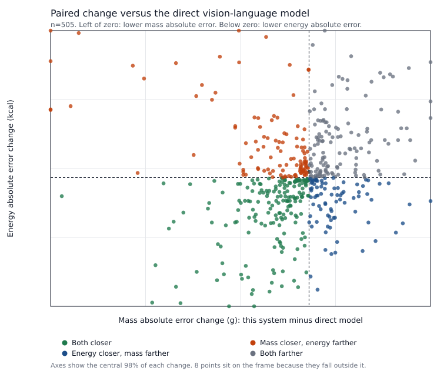
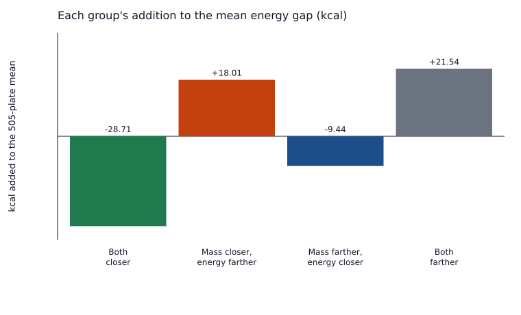
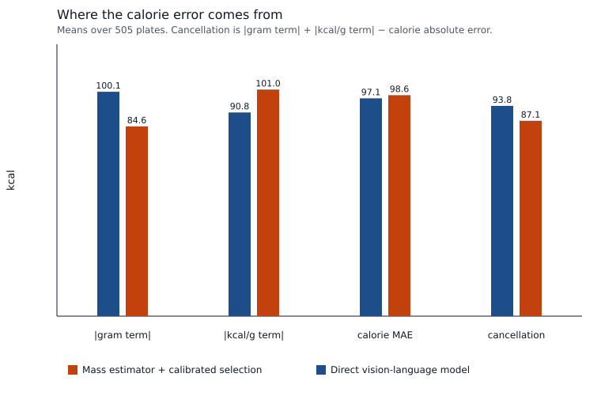

# Error audit: mass fell, full-set energy stayed above the direct model

On the 505 paired overhead plates, the mass estimator with calibrated Q/Cost selection has mass MAE **58.9952 g** and energy MAE **98.5521 kcal**. The direct vision-language model has mass MAE **76.3465 g** and energy MAE **97.1312 kcal**. The paired changes are **ΔM -17.3513 g** and **ΔE +1.4210 kcal** (this system minus the direct model). Mass MAE is 22.7% lower. Energy MAE is 1.5% higher.

The mass gap is stable and the energy gap is a small remainder. A 10,000-draw bootstrap that resamples plates (numpy Generator seed 0) gives a 95% percentile interval of **[-24.94, -10.13] g** for mass. Every draw has a negative mass mean. The same interval for energy is **[-8.10, +11.05] kcal**, and 38.6% of draws have a negative energy mean. The median paired energy change is **-4.54 kcal**. Energy absolute error is lower on **264** plates and higher on **241**. A 10% trim of each tail leaves an energy-change mean of -0.77 kcal. Removing the 2 largest energy-absolute-error increases (`dish_1562172643` (+426.1 kcal), `dish_1564675411` (+360.8 kcal)) leaves a mean energy change of -0.14 kcal on the other 503 plates. That removal is a sensitivity check. The published MAE still includes those plates.

The pooled energy mean is the mixture of two plate sets. On **199** plates where every named component received a mass write, energy MAE is 80.06 versus 91.02 (Δ -10.96 kcal) and mass MAE is 22.44 versus 61.61 (Δ -39.17 g). That set contributes -4.32 kcal to the 505-plate energy mean. On the other **306** plates, at least one named component has no mass write. Energy MAE is 110.58 versus 101.10 (Δ +9.47 kcal) and mass MAE is 82.77 versus 85.93 (Δ -3.16 g). That set contributes +5.74 kcal. The unfinished set is larger, and its higher energy error leaves the pooled mean at +1.42 kcal.

Inside the finished set, the 149 one-component plates have ΔE -17.99 kcal and ΔM -21.50 g. The 50 multi-component plates have ΔE +10.01 kcal and ΔM -91.80 g. The pooled energy win on finished plates is the one-component group. The multi-component group is where a large mass win sits next to a higher energy MAE.

The committed calorie is the selected food code's FNDDS kcal per 100 g times the written grams. On the finished plates the written grams match the specialist's dish mass to 0.005 g on average, while the committed calories differ from the specialist's own calorie head by 76.83 kcal on average. That stored head has energy MAE 36.91 kcal on these 199 plates. The food-table commit on the same plates has 80.06 kcal, and the direct model has 91.02 kcal. The full-set score uses the food-table product. The head is a stored forward pass, scored here only as a reading of what the commit did not use.

Closed-loop control, the earlier controller without this mass estimator, has energy MAE 100.4110 kcal and mass MAE 62.4099 g on the same 505 plates. The mass estimator changes that by ΔE -1.8588 kcal (95% interval [-13.00, +9.29]) and ΔM -3.4147 g (95% interval [-10.03, +3.05]). Both of those intervals contain negative and positive values. The point estimates are lower than closed-loop control, and the energy point estimate stays above the direct model.

## What was measured

The paired table, the per-plate rows, and the mass-estimator trace are the P0d artifacts. Protein, carbohydrate, and fat come from the frozen direct-model file for the same plates. Labels score residuals. No threshold, code, or gram weight was chosen from these labels. No model was trained. `docs/STATUS.md` was not edited.

A committed calorie is kcal/g times grams. With both masses positive the signed calorie error splits exactly into

`predicted kcal/g × (predicted grams − label grams) + label grams × (predicted kcal/g − label kcal/g)`.

The first term is the gram term. The second is the food-density term. Cancellation is `|gram term| + |density term| − |calorie error|`, the part of the two terms that offsets inside the absolute error. Two further calorie totals keep one saved factor and replace the other with the label. Those totals are arithmetic on the saved predictions. They were not commits.

## How the plates split

Mass absolute error is lower on **292** plates, higher on **212**, and tied on **1**. The median paired mass change is -8.12 g. Median absolute errors are 37.46 g versus 48.00 g for mass, and 59.04 kcal versus 63.51 kcal for energy. The positive energy-absolute-error gaps sum to 19987 kcal of plate-level difference. The 10 largest are 15.7% of that positive sum, so the upper side is a broad set plus a short extreme tail. Energy-change quantiles (kcal): p05 -196.7, p10 -123.7, p25 -52.6, p50 -4.5, p75 +54.5, p90 +132.6, p95 +214.8, p99 +298.2.

| Group | Plates | Mean energy change (kcal) | Mean mass change (g) | Addition to the 505-plate energy mean (kcal) |
|---|---:|---:|---:|---:|
| Mass and energy both closer | 180 | -80.56 | -60.27 | -28.71 |
| Mass closer, energy farther | 112 | +81.21 | -70.19 | +18.01 |
| Mass farther, energy closer | 84 | -56.78 | +40.46 | -9.44 |
| Mass and energy both farther | 128 | +84.99 | +51.16 | +21.54 |

These four groups add +1.40 kcal. The one tied plate adds +0.03 kcal, and the total is +1.42 kcal. Plates where both errors got closer contribute -28.71 kcal. Plates where mass got closer and energy got farther contribute +18.01 kcal. Plates where both got farther contribute +21.54 kcal. The mean is what remains after those large groups offset.





On the 112 plates where mass got closer and energy got farther, the mean mass change is -70.2 g and the mean energy change is +81.2 kcal. The direct model's gram error and kcal/g error have opposite signs on 80.4% of them, and this system's gram and kcal/g errors have opposite signs on 45.5%. kcal/g absolute error is higher than the direct model's on 55.4% of them. Moving the grams toward the label removes a cancellation that had been holding the direct model's calorie error down.

Among the plates whose mass absolute error fell:

| kcal/g absolute error versus the direct model | Energy closer | Energy farther |
|---|---:|---:|
| Lower | 125 | 50 |
| Higher | 55 | 62 |

## Gram term and food-density term

| | Mass MAE (g) | Energy MAE (kcal) | kcal/g MAE | Mean \|gram term\| (kcal) | Mean \|kcal/g term\| (kcal) | Mean cancellation (kcal) | Mean signed calorie error (kcal) |
|---|---:|---:|---:|---:|---:|---:|---:|
| Mass estimator + calibrated selection | 59.00 | 98.55 | 0.512 | 84.6 | 101.0 | 87.1 | -30.0 |
| Direct vision-language model | 76.35 | 97.13 | 0.533 | 100.1 | 90.8 | 93.8 | -3.7 |
| Closed-loop control | 62.41 | 100.41 | 0.427 | 85.9 | 85.8 | 71.3 | +33.7 |

Mean signed calorie error for this system is -30.0 kcal, from a gram term of -59.3 kcal and a density term of +29.3 kcal. The direct model's signed error is -3.7 kcal (-13.7 from grams, +10.0 from kcal/g). Gram error and kcal/g error have opposite signs on 51.5% of plates here and on 60.6% for the direct model. Their correlation is -0.205 here and -0.297 for the direct model.

Unweighted kcal/g absolute error is slightly lower for this system (0.512 versus 0.533 kcal/g). The calorie-valued density term, label grams times that kcal/g error, is higher (101.0 versus 90.8 kcal). The direct model also cancels more of the gram term against the density term (93.8 versus 87.1 kcal).

Replacing the saved grams with the label grams, and keeping the saved kcal/g, gives energy MAE **101.05 kcal** here and **90.84 kcal** for the direct model. Replacing the saved kcal/g with the label kcal/g, and keeping the saved grams, gives energy MAE **75.02 kcal** here and **102.18 kcal** for the direct model. The scored energy MAEs are 98.55 and 97.13. At the label kcal/g, this system's grams would produce the lower calorie error. At the saved kcal/g, even label grams would leave this system's calorie error above the direct model's scored MAE.



Signed calorie error by whether every named component was mass-written:

- Finished plates: this system +33.4 kcal, direct model -31.1 kcal. Signed mass error +5.8 g versus -26.7 g.
- Unfinished plates: this system -71.2 kcal, direct model +14.1 kcal. Signed mass error -73.5 g versus +8.3 g.

## Food codes after the gram write

The two plates whose removal brings the mean energy change to zero or below:

- `dish_1562172643` (energy absolute-error change +426.1 kcal, mass -105.5 g).
  Label 457.0 g / 734.3 kcal.
  This system 508.5 g / 1294.6 kcal.
  Direct model 300.0 g / 600.0 kcal.
  Foods written: Egg omelet or scrambled egg, no added fat (203.4 g, was 100.0 g, 143.0 kcal/100 g); Bacon, for use on a sandwich (135.6 g, was 100.0 g, 494.0 kcal/100 g); Potato, home fries, NFS (169.5 g, was 100.0 g, 197.0 kcal/100 g).
- `dish_1564675411` (energy absolute-error change +360.8 kcal, mass +23.6 g).
  Label 308.0 g / 235.5 kcal.
  This system 339.6 g / 810.8 kcal.
  Direct model 300.0 g / 450.0 kcal.
  Foods written: Bacon, for use on a sandwich (92.6 g, was 100.0 g, 494.0 kcal/100 g); Egg omelet or scrambled egg, no added fat (247.0 g, was 100.0 g, 143.0 kcal/100 g).

Both of those plates mass-wrote every named component, and both commits include a bacon code at 494 kcal/100 g.

Two more plates where mass got closer and energy got farther:

- `dish_1565811061` (ABSTAIN, 3 of 4 named components mass-written).
  Label 324.0 g / 380.3 kcal (117.4 kcal/100 g).
  This system 277.0 g / 95.8 kcal (34.6 kcal/100 g).
  Direct model 400.0 g / 350.0 kcal (87.5 kcal/100 g).
  Absolute-error change: mass -29.0 g, energy +254.2 kcal.
  Foods written: Spinach, raw (114.6 g, was 100.0 g, 27.0 kcal/100 g); Carrots, raw (76.4 g, was 100.0 g, 41.0 kcal/100 g); Broccoli, raw (86.0 g, was 100.0 g, 39.0 kcal/100 g).
- `dish_1566920304` (ABSTAIN, 1 of 1 named components mass-written).
  Label 570.0 g / 296.4 kcal (52.0 kcal/100 g).
  This system 545.0 g / 779.3 kcal (143.0 kcal/100 g).
  Direct model 150.0 g / 150.0 kcal (100.0 kcal/100 g).
  Absolute-error change: mass -395.0 g, energy +336.5 kcal.
  Foods written: Cottage cheese, farmer's (545.0 g, was 100.0 g, 143.0 kcal/100 g).

Holding the written food codes fixed, the earlier gram guess and the mass-estimator grams can be compared on 481 plates whose committed total matches the sum of the written components within 0.05 kcal and 0.05 g. Mass MAE moves from 78.66 g to 58.43 g (-20.24 g). Energy MAE moves from 114.67 kcal to 96.77 kcal (-17.90 kcal). On 96 of these plates the rewrite lowers mass absolute error and raises energy absolute error, and the set-level energy MAE still falls. The earlier grams are the grams already stored on that component before the mass write, rather than the direct model's plate mass.

On the 149 finished one-component plates, committed kcal/g is that code's kcal/g. kcal/g absolute error is 0.286 kcal/g here and 0.720 kcal/g for the direct model. Energy MAE is 42.91 versus 60.90 kcal. Mass MAE is 15.11 versus 36.61 g. The stored calorie head on these plates has energy MAE 23.21 kcal, with mass MAE 15.12 g.

On the 50 finished multi-component plates the stored head has energy MAE 77.75 kcal and mass MAE 44.30 g. The food-table commit has energy MAE 190.79 kcal and mass MAE 44.30 g. The direct model has energy MAE 180.78 kcal and mass MAE 136.10 g. The grams match the head. The calorie gap between the head and the commit is the summed food-code table.

Protein, carbohydrate, and fat use the committed vectors. Bias is prediction minus label.

| Nutrient | n | This system MAE | Direct model MAE | Δ MAE | This system bias | Direct model bias |
|---|---:|---:|---:|---:|---:|---:|
| Protein (g) | 505 | 6.91 | 8.77 | -1.86 | -3.65 | -3.53 |
| Carbohydrate (g) | 505 | 9.70 | 10.40 | -0.70 | -4.31 | +4.14 |
| Fat (g) | 505 | 7.66 | 6.63 | +1.02 | -0.49 | -3.86 |

Fat MAE is higher by +1.02 g. The signed fat error is -0.49 g here and -3.86 g for the direct model, so the higher fat MAE is a wider scatter. Protein and carbohydrate MAEs are lower, and both are signed low.

## STOP, ABSTAIN, and unfinished components

The full-set MAE scores the vector at the first STOP or ABSTAIN, including abstentions. Trace totals match the paired commit on 505/505 plates. Portions clipped to the 1 g or 1500 g bound: 1.

| Slice | n | Energy MAE, this system | Energy MAE, direct | ΔE | Mass MAE, this system | Mass MAE, direct | ΔM |
|---|---:|---:|---:|---:|---:|---:|---:|
| STOP | 276 | 96.70 | 94.73 | +1.98 | 45.25 | 71.24 | -25.99 |
| ABSTAIN | 206 | 97.15 | 98.44 | -1.29 | 75.85 | 81.54 | -5.69 |
| Ended on CORRECT_CODE | 23 | 133.25 | 114.25 | +19.00 | 72.94 | 91.04 | -18.10 |
| Every named component mass-written | 199 | 80.06 | 91.02 | -10.96 | 22.44 | 61.61 | -39.17 |
| A named component left unwritten | 306 | 110.58 | 101.10 | +9.47 | 82.77 | 85.93 | -3.16 |
| One component, mass-written | 149 | 42.91 | 60.90 | -17.99 | 15.11 | 36.61 | -21.50 |
| Several components, all mass-written | 50 | 190.79 | 180.78 | +10.01 | 44.30 | 136.10 | -91.80 |
| No CORRECT_CODE through the commit | 471 | 95.93 | 95.20 | +0.73 | 57.84 | 74.63 | -16.79 |
| At least one CORRECT_CODE | 34 | 134.90 | 123.88 | +11.02 | 74.99 | 100.09 | -25.10 |

| Decision | Components | n | Mean ΔE (kcal) | Mean ΔM (g) | Addition to the energy mean (kcal) | Mean signed calorie error, this system |
|---|---|---:|---:|---:|---:|---:|
| STOP | every component mass-written | 198 | -12.71 | -37.37 | -4.98 | +31.1 |
| STOP | a named component left unwritten | 78 | +39.26 | +2.89 | +6.06 | -87.6 |
| ABSTAIN | every component mass-written | 1 | +336.55 | -395.00 | +0.67 | +482.9 |
| ABSTAIN | a named component left unwritten | 205 | -2.93 | -3.79 | -1.19 | -63.6 |
| CORRECT_CODE | a named component left unwritten | 23 | +19.00 | -18.10 | +0.87 | -83.5 |

ABSTAIN is included in the full-set MAE. On this pool its energy MAE is lower than the direct model's. The cross-tab shows where the pooled mean comes from: 198 finished STOP plates add -4.98 kcal, and 78 STOP plates with a component left unwritten add +6.06 kcal. The 23 CORRECT_CODE endings add +0.87 kcal. 15 paired plates never call the mass estimator (all 15 end on CORRECT_CODE).

## Q/Cost and the rule-utility fence

The trace does not store the fence decision. Replaying the frozen Q weights and the saved fence (τ = 0.001645) reproduces **2858/2858** logged actions, with 0 scoring failures. 1995 matched steps are the Q/Cost choice and 863 are rule-utility steps. A rule-utility step is a case where Q/Cost preferred STOP or ABSTAIN by less than the fence, and the rule chose a tool instead. The committing action is Q/Cost on 505 paired plates and rule utility on 0. Every paired plate contains at least one rule-utility step (n=505), and every committing action is Q/Cost. This audit does not resimulate the trajectories with the fence removed.

## What stays in place

The published full-set comparison stands. Mass MAE is lower by 17.3513 g, and that gap's bootstrap interval lies below zero. Energy MAE is higher by 1.4210 kcal, and that gap's interval contains both signs. The median plate has a lower energy absolute error. Finished one-component plates have lower mass and energy MAE. Finished multi-component plates have a much lower mass MAE and a higher energy MAE, and the stored calorie head on those plates is closer than the summed food codes. The 78 STOP plates that leave a named component unwritten have a mean signed calorie error of -87.6 kcal and add +6.06 kcal to the pooled energy mean. Versus the grams already on the component, the mass write lowers both mass MAE and energy MAE. Versus closed-loop control, the point estimates are lower and the paired intervals contain both signs.

This note does not start a mass retrain, a Q retrain, a retrieval re-rank, or another full-set run. The label-gram and label-density totals are arithmetic. They are not proposed commits.

## Reproduce

```bash
python scripts/p0d_error_audit.py
```

Reads `results/p0d/same_budget.json`, `same_budget_dishes.jsonl`, `ours_new_rgb_test.jsonl`, `ours_new_rgb_test_summary.json`, `report_same_budget.txt`, the frozen direct-model jsonl for macros, and the frozen Q weights only to replay actions. Input sha256 prefixes: dishes `3b6324cbf8269dba`, table `837dfb12b03390f4`, trace `fdeb8b3292c215a6`, direct `a4dfdd82e3a595f4`, Q `a59ba6e49cf45220`.

