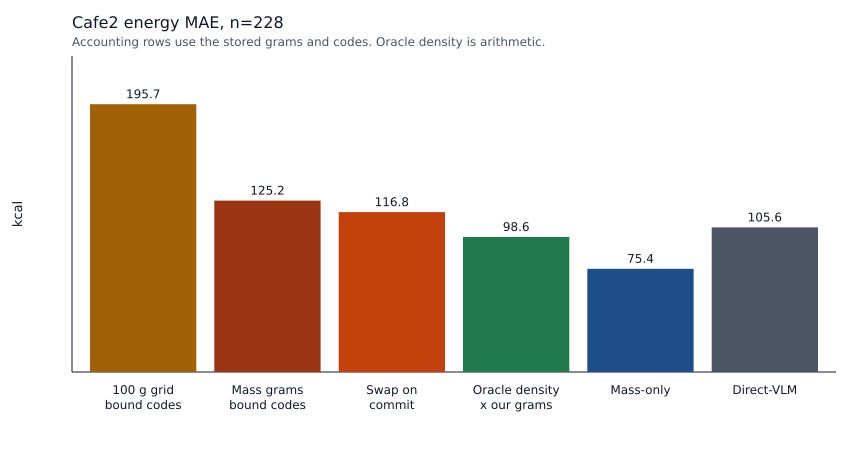
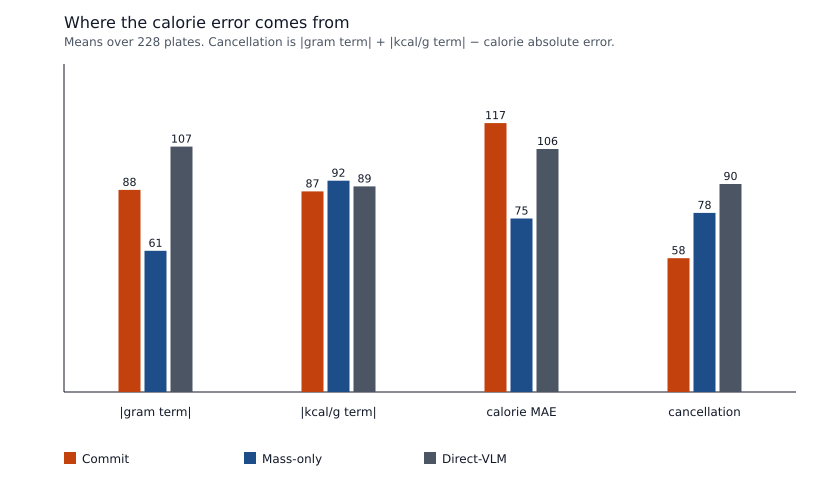

# Cafe2 energy audit

**质量稳赢可外推；能量开发集赢、外测未稳。**

On the frozen Cafe2 held-out, n=228, the coverage-constrained commit has energy MAE **116.8494 kcal** and mass MAE **50.9483 g**. Direct-VLM has **105.6157 kcal** and **73.7456 g**. Mass-only has **75.3870 kcal** and **51.7107 g**. Versus Mass-only the commit is **+41.4624 kcal** and **-0.7625 g**. Versus Direct-VLM it is **+11.2337 kcal** and **-22.7973 g**.

The +41.4624 kcal is the food-table density on grams that match Mass-only. On **222** of the 228 plates the committed gram total and the Mass-only gram total differ by less than 0.001 g, and the energy MAE gap on those plates is **+43.12 kcal**. The commit multiplies those grams by the selected FNDDS kcal per 100 g. Mass-only scores the frozen mass estimator's calorie head on the same grams. The **58** one-component plates, where a same-head swap is ineligible, contribute **+29.62 kcal** of the +41.46 mean. Their energy MAE is 154.51 versus Mass-only 38.06, at the same mass MAE 50.94 g.

A 10,000-draw bootstrap that resamples plates (numpy Generator seed 0) puts the energy gap versus Mass-only at **[+25.35, +58.28] kcal**. 100.0% of draws keep a positive mean. The mass gap versus Mass-only is **[-2.33, +0.10] g**, and that interval contains both signs. Versus Direct-VLM, the mass interval is **[-29.80, -15.66] g** with every draw negative, and the energy interval is **[-6.22, +29.16] kcal**, which contains both signs. Mass versus Direct-VLM stays ahead on this external set. The development-set energy win does not reappear here.

The development 505 energy MAE 64.2792 and mass MAE 32.9908 are not rows of this table.

## What was measured

The plate list, the trajectories, and the Direct-VLM and Mass-only scores are the frozen #63 artifacts. Cafe2 was re-read: **238** rows, dish-level energy column **0** on every row. The energy target on the 228 is the sum of ingredient calories, and it matches the stored score labels. Mass is the dish-level gram total. Labels score residuals. No threshold, code, or gram was chosen from them. No model was trained. `docs/STATUS.md` was not edited.

A calorie is kcal/g times grams. With both masses positive the signed calorie error splits exactly into

`predicted kcal/g × (predicted grams − label grams) + label grams × (predicted kcal/g − label kcal/g)`.

The first term is the gram term. The second is the food-density term. Cancellation is `|gram term| + |density term| − |calorie error|`. Two further calorie totals keep one saved factor and replace the other with the label. Those totals are arithmetic. They were not commits.

The bound-code total is the food-table sum at the mass-estimator grams before the same-head swap. When the rollout stored an align record, that total is `before_energy_kcal`. On a one-component plate the rollout stores no align record, and the commit is already that total. Bound-code energy and the swap-off energy differ by at most **0.0001 kcal** on a plate. The largest food-table accounting gap against the summed component energies is **0.0004 kcal** and **0.0000 g**, inside the 0.05 tolerance on all 228 plates.

## Codes held fixed

Every one of the **575** mass writes replaced a **100 g** grid portion. The food code on that write stays the bound code. At the grid grams, energy MAE is **195.6564 kcal** and mass MAE is **116.9123 g**. At the mass-estimator grams, with those same codes, energy MAE is **125.2060 kcal** and mass MAE is **50.9483 g**. The rewrite changes energy MAE by **-70.4504 kcal** and mass MAE by **-65.9640 g**.

Mass absolute error falls on **172** plates. Energy absolute error falls on **147** and rises on **81**. **127** plates lose mass error and energy error together. **45** lose mass error while energy error rises. On the full 228, holding the bound codes fixed, the mass rewrite lowers energy MAE and mass MAE together.

The pooled drop comes from the multi-component plates. With those codes held fixed, energy MAE moves from **216.37** to **115.21 kcal** and mass MAE from **138.41** to **50.95 g**. On the **58** one-component plates the same rewrite moves energy MAE from **134.93** to **154.51 kcal** and mass MAE from **53.91** to **50.94 g**. A same-head swap cannot fire on a one-component plate, so the commit and the bound-code total are the same number there. Those plates are also the largest share of the energy gap versus Mass-only.

Components that never received a mass write stay out of both totals. The **6** plates that ended on RETRIEVE are in this comparison: their commit is exactly the components that were written, and the rollout does not invent the missing portions. Those six plates are the whole **-0.7625 g** mass gap versus Mass-only (contribution -0.7625 g). Their energy contribution to the +41.46 mean is -0.52 kcal.

## Oracle label density

Label density times our grams has energy MAE **98.6201 kcal**. The same label density times Mass-only grams has **100.3152 kcal**, and times Direct-VLM grams has **129.5613 kcal**. Our saved kcal/g times the label grams has energy MAE **87.1905 kcal**. The bound-code kcal/g times the label grams has **94.0142 kcal**. The calorie head times the label grams has **91.8416 kcal**.

At the cafe kcal/g, our grams land at 98.62 kcal MAE, which is below the food-table commit (116.85) and below Direct-VLM (105.62). Mass-only's scored energy MAE remains lower, at 75.39. Unweighted kcal/g absolute error is **0.631 kcal/g** for the commit and **0.753 kcal/g** for the calorie head. Mean cancellation is 58.2 kcal for the commit and 77.8 kcal for the head. The head's mean signed calorie error is -22.8 kcal (+43.3 from grams, -66.0 from kcal/g). The commit's mean signed error is +64.3 kcal (+64.1 from grams, +0.1 from kcal/g).

## Density swap on and off

The frozen same-head swap fired on **106** plates and left **122** unchanged. With those swapped codes put back, full-set energy MAE is **125.2060 kcal**. With the swap left on, it is **116.8494 kcal**. The swap changes full-set energy MAE by **-8.3566 kcal**. Mass is unchanged. The gap versus Mass-only is **+49.8190 kcal** with the swap off and **+41.4624 kcal** with the swap on.

On the 106 plates, energy MAE is 105.5986 with the swap off and **87.6241** with it on. Mass-only on the same 106 is 80.8236. Direct-VLM is 107.4369. The swap moves all **106** food-table totals closer to the calorie head (mean absolute gap 102.41 kcal to 56.58 kcal). It moves **67** closer to the cafe label and **39** farther. Mean signed energy change on those plates is -15.94 kcal. Changed-code counts on the 106: 1 code on 48 plates, 2 codes on 36 plates, 3 codes on 12 plates, 4 codes on 10 plates.

This swap is the #51 density/kcal heuristic. It chooses the candidate whose food-table energy is closer to the calorie head. On the development food-code audit the automatic Exact count after a swap was 0. A lower calorie error here is a score against the ingredient-calorie sum. It is not an identity correction.

The 122 plates with no swap contribute **+38.30 kcal** of the +41.46 mean. The 106 swapped plates contribute **+3.16 kcal**.

## Where the energy gap sits

Energy absolute error is lower than Mass-only on **87** plates and higher on **141**. The median plate-level gap is **+13.27 kcal**. Quantiles of commit minus Mass-only energy absolute error (kcal): p05 -129.1, p10 -81.4, p25 -13.5, p50 +13.3, p75 +92.9, p90 +170.6, p95 +260.1. The positive gaps sum to 14268 kcal, and the 10 largest are 29.6% of that sum.

Median absolute errors are 89.50 versus 48.86 kcal for energy, and 48.23 versus 48.94 g for mass. Mean |commit − calorie head| is 100.01 kcal.

Energy MAE by slice. The last column is that slice's addition to the 228-plate mean energy gap versus Mass-only.

| Slice | n | Commit | Swap off | Prior grams | Oracle density × our grams | Mass-only | Direct-VLM | Addition to +41.46 |
|---|---:|---:|---:|---:|---:|---:|---:|---:|
| all | 228 | 116.85 | 125.21 | 195.66 | 98.62 | 75.39 | 105.62 | +41.46 |
| complete | 222 | 117.33 | 125.91 | 196.66 | 99.67 | 74.20 | 102.97 | +41.99 |
| incomplete | 6 | 99.20 | 99.20 | 158.52 | 59.81 | 119.13 | 203.52 | -0.52 |
| single_component | 58 | 154.51 | 154.51 | 134.93 | 116.08 | 38.06 | 65.26 | +29.62 |
| multi_component | 170 | 104.00 | 115.21 | 216.37 | 92.66 | 88.12 | 119.38 | +11.84 |
| complete_multi | 164 | 104.18 | 115.79 | 218.49 | 93.87 | 86.99 | 116.31 | +12.36 |
| swap_applied | 106 | 87.62 | 105.60 | 188.22 | 94.42 | 80.82 | 107.44 | +3.16 |
| swap_not_applied | 122 | 142.24 | 142.24 | 202.12 | 102.27 | 70.66 | 104.03 | +38.30 |

One-component plates add +29.62 kcal. Multi-component plates add +11.84 kcal. On complete multi-component plates the commit energy MAE is 104.18, swap-off is 115.79, Mass-only is 86.99, and Direct-VLM is 116.31, with mass MAE 51.39 g against Direct-VLM 79.62 g.



## Gram term and food-density term

| | Mass MAE (g) | Energy MAE (kcal) | kcal/g MAE | Mean \|gram term\| | Mean \|kcal/g term\| | Mean cancellation | Mean signed calorie error |
|---|---:|---:|---:|---:|---:|---:|---:|
| Commit, swap on | 50.95 | 116.85 | 0.631 | 87.8 | 87.2 | 58.2 | +64.3 |
| Bound codes, swap off | 50.95 | 125.21 | 0.666 | 89.1 | 94.0 | 57.9 | +71.7 |
| 100 g grid, bound codes | 116.91 | 195.66 | 0.678 | 185.2 | 97.0 | 86.5 | +144.5 |
| Mass-only calorie head | 51.71 | 75.39 | 0.753 | 61.4 | 91.8 | 77.8 | -22.8 |
| Direct-VLM | 73.75 | 105.62 | 0.700 | 106.6 | 89.4 | 90.4 | +39.6 |

Gram error and kcal/g error have opposite signs on 58.8% of plates for the commit, 76.8% for Mass-only, and 64.9% for Direct-VLM.



## Readings

These plates are the largest one-component energy-absolute-error gaps versus Mass-only, plus the swap that most reduces label absolute error and the swap that most increases it. They illustrate the density assignment. They were not used to choose a code or a gram.

- `dish_1572541487` (one component, largest energy gap versus Mass-only).
  Label 199.0 g / 117.4 kcal (59.0 kcal/100 g).
  Commit 158.4 g / 947.5 kcal. Bound codes at the same grams 947.5 kcal. Prior grams 598.0 kcal.
  Mass-only 158.4 g / 153.4 kcal. Direct-VLM 50.0 g / 150.0 kcal.
  Bound foods at the mass write: Almonds, NFS (158.4 g, was 100.0 g, 598.0 kcal/100 g, code 42100100).
  Swap changes: none.
- `dish_1573491305` (one component).
  Label 70.0 g / 36.4 kcal (52.0 kcal/100 g).
  Commit 100.7 g / 541.8 kcal. Bound codes at the same grams 541.8 kcal. Prior grams 538.0 kcal.
  Mass-only 100.7 g / 34.0 kcal. Direct-VLM 50.0 g / 100.0 kcal.
  Bound foods at the mass write: Popcorn, NFS (100.7 g, was 100.0 g, 538.0 kcal/100 g, code 54403001).
  Swap changes: none.
- `dish_1572278894` (one component).
  Label 61.0 g / 330.0 kcal (541.0 kcal/100 g).
  Commit 143.5 g / 709.0 kcal. Bound codes at the same grams 709.0 kcal. Prior grams 494.0 kcal.
  Mass-only 143.5 g / 349.4 kcal. Direct-VLM 70.0 g / 120.0 kcal.
  Bound foods at the mass write: Bacon, for use on a sandwich (143.5 g, was 100.0 g, 494.0 kcal/100 g, code 89902100).
  Swap changes: none.
- `dish_1573851651` (swap, largest drop in label absolute error).
  Label 420.0 g / 378.4 kcal (90.1 kcal/100 g).
  Commit 362.3 g / 430.0 kcal. Bound codes at the same grams 590.8 kcal. Prior grams 584.0 kcal.
  Mass-only 362.3 g / 426.3 kcal. Direct-VLM 500.0 g / 600.0 kcal.
  Bound foods at the mass write: Chicken, back (120.8 g, was 100.0 g, 298.0 kcal/100 g, code 24170200); Rice, cooked, NFS (100.6 g, was 100.0 g, 129.0 kcal/100 g, code 56205000); Green beans, raw (80.5 g, was 100.0 g, 31.0 kcal/100 g, code 75101800); Potato, NFS (60.4 g, was 100.0 g, 126.0 kcal/100 g, code 71000100).
  Swap changes: chicken: Chicken, back → Chicken, canned, meat only; rice: Rice, cooked, NFS → Rice, white, cooked, glutinous; green beans: Green beans, raw → Green beans, NS as to form, cooked; potato: Potato, NFS → Potato, mashed, NFS.
- `dish_1573849915` (swap, largest rise in label absolute error).
  Label 239.0 g / 431.7 kcal (180.6 kcal/100 g).
  Commit 266.3 g / 273.4 kcal. Bound codes at the same grams 417.2 kcal. Prior grams 345.0 kcal.
  Mass-only 266.3 g / 193.0 kcal. Direct-VLM 300.0 g / 350.0 kcal.
  Bound foods at the mass write: Dumpling, no meat (177.6 g, was 100.0 g, 125.0 kcal/100 g, code 55610300); Fried green beans (88.8 g, was 100.0 g, 220.0 kcal/100 g, code 75205200).
  Swap changes: stir-fried greens: Fried green beans → Greens, NS as to form, cooked.

## What stays in place

The #63 table stands. Mass MAE is lower than Direct-VLM by 22.7973 g, and that gap's bootstrap interval lies below zero. Energy MAE is higher than Direct-VLM by 11.2337 kcal, and that gap's interval contains both signs. Energy MAE is higher than Mass-only by 41.4624 kcal, and that gap's interval lies above zero. On 222 plates the gram totals match, so that energy gap is the FNDDS product versus the calorie head. On the full 228, the mass rewrite with codes held fixed lowers both mass MAE and energy MAE relative to the 100 g grid. On the 58 one-component plates that rewrite raises energy MAE from 134.93 to 154.51. The stored swap lowers full-set energy MAE by a further 8.3566 kcal. The remaining gap versus Mass-only is concentrated on the one-component plates, which the swap does not touch.

This note does not start a mass retrain, a Q retrain, a τ refit, a retrieval re-rank, gate ④ real tool cost, gate ⑤, gate ⑥, or gate ⑦. There is no RL. The label-density and label-gram totals are arithmetic. They are not proposed commits. Direct-VLM in the frozen rows used `placement_max_memory=8GiB` on 228 / 228 plates. Those rows were not rerun. The frozen summary records 0 hollow RE_PORTION writes. #51 remains a density/kcal heuristic.

## Reproduce

```bash
python scripts/heldout_energy_audit.py
```

Reads `results/heldout_plan/heldout_dish_ids.txt`, `results/heldout_eval/scores.jsonl`, `rollout.jsonl`, `direct_vlm.jsonl`, `mass_only.jsonl`, and `summary.json`, plus the cafe2 metadata for the label check. Input sha256 prefixes: scores `849c9781a456788b`, rollout `8ce6ccaf5fc3d3cd`, direct `076d135d3ea0067e`, mass `54d4fce9b638b8fd`, summary `81198046666cc8c7`, report `db47ad8cffa78619`, heldout_ids `0dc24b471b217d21`, dev505_ids `36d4534d6e8e8a3f`, fit_ids `d4cd748b863f54ab`, plan_proof `5ed107b20d220ebe`, status `3b4224f93078283f`.

