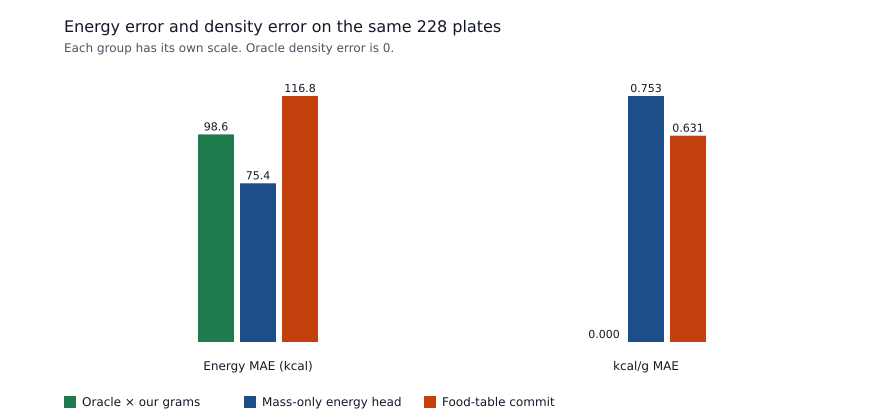
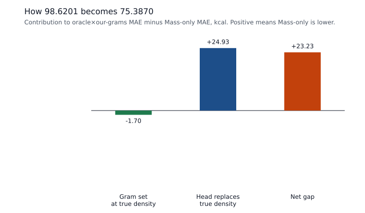

# Mass-only energy path

**质量稳赢可外推；能量开发集赢、外测未稳。**

Oracle label density × our grams has energy MAE **98.6201 kcal**. Mass-only has energy MAE **75.3870 kcal**. The **23.2332 kcal** gap is the excess signed cancellation at the Mass-only grams, **24.9283 kcal**, minus the **1.6951 kcal** rise that comes from scoring the true density on the Mass-only grams instead of our grams. Unweighted kcal/g MAE is **0** for the oracle density, **0.631** for the food-table commit, and **0.753** for the calorie head. The #65 channel cancellation is **0**, **58.2**, and **77.8 kcal** on those same three rows. Mass-only energy has no food code.

The development 505 energy MAE 64.2792 and mass MAE 32.9908 are not rows of this table.

## Answers

1. This directory is only the Mass-only energy-path diagnostic on the frozen Cafe2 list, n=228. No method, hyperparameter, early stop, or model selection was changed.
2. Mass-only energy is the frozen mass estimator's dish-level energy head: `estimate_mass(...).nutrients.energy_kcal`, backbone `vit_b_16`, targets `mass_g`, `energy_kcal`, `protein_g`, `carb_g`, `fat_g` in that order. The scorer does not multiply a food density by grams and does not read a food-id. The food-table commit is the selected FNDDS kcal/100 g times component grams, summed. Oracle × our grams is the label kcal/g times those committed grams. On **222** / 228 plates the mass head matches the committed grams within 0.001 g (measured maximum **0.0002 g**). On those plates the energy head equals implied kcal/g times the committed grams within **0.0002 kcal**.
3. **98.6201** versus **75.3870** is greater signed cancellation. The calorie head's unweighted kcal/g MAE **0.753** is larger than the food table's **0.631** and larger than the oracle's **0**. #65's cancellation figures stand: **77.8** kcal for the head and **58.2** kcal for the food table. The head is closer than the food table on **89** plates and farther on **139**. Replacing the head's density with the label density, at the head's own grams, would raise energy MAE from **75.3870** to **100.3152**.
4. After this diagnostic, gate ④, gate ⑤, gate ⑥, gate ⑦, and P1 stay locked. Mass, Q, and τ were not retrained. `docs/STATUS.md` was not edited.

## How the three energies are scored

Cafe2 was re-read: **238** rows, dish-level energy column **0** on every row. The energy target on the 228 is the sum of ingredient calories, and it matches the stored score labels. Mass is the dish-level gram total. Labels score residuals. No threshold, code, or gram was chosen from them. No model was trained.

The frozen plan proof records an empty intersection of these 228 ids with rgb_train, with the fit set the mass estimator trained on (overhead RGB subset of fit, n=2498), and with the development 505. This run rechecked those three id lists. The intersection is empty. The checkpoint meta says the weights are the last train epoch, not a hold-out selection, and that rgb_test labels were not used.

### Mass-only

`scripts/heldout_eval.py` calls `estimate_mass` on the overhead RGB and stores `nutrients.energy_kcal` and `mass_g`. It does not pass food candidates. The network emits five means in standardized space and denormalizes each one on its own. The tool then clips each mean at 0 and rounds to 4 decimals. `nutrients.energy_kcal` is that energy mean. It is not an FNDDS lookup and it is not a food code.

The frozen `mass_only.jsonl` rows confirm the path. All **228** have backbone `vit_b_16`, tool `estimate_mass`, `rgb_only` true, and `depth_used` false. The fields are dish id, energy, mass, backbone, tool, and the two RGB flags. There is no food-id. All **575** mass writes before the scored commit store `obs_t.nutrients_model.energy_kcal` equal to that energy (maximum absolute gap **0 kcal**) and the same value on every write of a plate (maximum span **0 kcal**). `nutrient_refs.model_rgb` repeats the five head outputs. Its mass equals the Mass-only mass. The nutrient object on the write has energy, protein, carb, and fat only.

The published Mass-only calorie is this energy head, **75.3870 kcal** MAE, beside the mass head, **51.7107 g** MAE. An implied kcal/g can be defined afterwards as energy divided by mass. Multiplying that ratio by the mass head returns the energy head. That identity is how the #65 channel split accounts the head. It is not a step in the scorer. On the **222** plates whose committed grams already match, implied kcal/g times the committed grams differs from the energy head by at most **0.0002 kcal**. The other **6** plates stopped on RETRIEVE with a partial gram total. Mass-only still scores the full-dish head on those plates. Their largest gram gap is **164.0 g**.

### Food-table commit

RE_PORTION takes the component grams from the same mass estimator, then looks up the bound FNDDS code and scales kcal per 100 g by grams / 100. The dish total is the sum of those component vectors. On the write that finishes a multi-component plate, a same-head swap may replace codes so that sum moves toward the energy head. The head is the target of the swap. The committed calorie remains the food-table sum. Scores record the swap on **106** plates. Mean |food-table energy − energy head| is **100.01 kcal**. #65 already checked that the food-table sum matches the commit within 0.0004 kcal on every plate. That check was not repeated as a second audit, and those files were not rewritten.

### Oracle × our grams

Label kcal/g times the committed grams has energy MAE **98.6201**. The density term is 0 and cancellation is 0, so this MAE is the mean absolute gram term at the true density. The same label density times the Mass-only grams has energy MAE **100.3152**. Both totals are arithmetic. They were not commits.

## 98.6201 versus 75.3870

Moving from our grams to the Mass-only grams, while keeping the true density, changes energy MAE from **98.6201** to **100.3152** (+1.6951 kcal). The true-density score is higher on the Mass-only grams, so the whole Mass-only advantage is the next step.

At the Mass-only grams, replacing the true density with the energy head changes energy MAE from **100.3152** to **75.3870** (-24.9283 kcal). 98.6201 + 1.6951 − 24.9283 = **75.3870**. The oracle-minus-head gap is **23.2332 kcal** = 24.9283 − 1.6951.

The second change is a density residual, `energy head − true density × Mass-only grams`. Its mean absolute size is **129.4878 kcal**. Cancellation of that residual against the true-density gram error averages **154.4161 kcal**. Cancellation here is |true-density gram error| + |density residual| − |energy-head error|. The excess of cancellation over the residual is **24.9283 kcal**, which is the whole MAE drop at those grams. The residual lowers absolute error on **136** plates and raises it on **92**.

Gram error and implied-density error have opposite signs on **175** / 228 plates (76.8%). Mean benefit on those plates is **+56.67 kcal**. On the other **53** plates the mean benefit is **-79.89 kcal**. Pearson correlation of gram error and implied-density error is **-0.336**. Mean signed gram error is **+35.67 g**. Mean signed implied-density error is **-0.629 kcal/g**. Mean |implied density| is **1.141 kcal/g** against label **1.770 kcal/g**.

The same residual test on the food table goes the other way. Mean |food-table energy − true density × our grams| is **109.3708 kcal**. Cancellation against that true-density gram error averages **91.1415 kcal**. The excess is **-18.2293 kcal**, and the food-table energy MAE is **116.8494**, above the oracle's **98.6201**.

A 10,000-draw bootstrap that resamples plates (numpy Generator seed 0) puts 98.6201 − 75.3870 at **[+7.92, +39.06] kcal**. 99.83% of draws keep a positive mean. This interval describes the frozen list. It was not used to choose a method.





| Path | Food-id | Grams | Energy MAE (kcal) | kcal/g MAE |
|---|---|---|---:|---:|
| Oracle density × our grams | label density | commit | 98.6201 | 0.000 |
| Oracle density × Mass-only grams | label density | mass head | 100.3152 | 0.000 |
| Energy head × our grams | none | commit | 75.1005 | 0.753 |
| Mass-only energy head | none | mass head | 75.3870 | 0.753 |
| Food-table commit | FNDDS, swap on 106 | commit | 116.8494 | 0.631 |

The row `Energy head × our grams` is the implied ratio times the committed grams. It equals the published energy head on the 222 matched plates. On the full 228 its MAE is **75.1005**, because the 6 partial plates use a different gram total. The published Mass-only figure remains the energy head, **75.3870**.

| | kcal/g MAE | Plates with the smaller kcal/g error | Median \|kcal/g error\| | Mean signed kcal/g error | Mean \|density term\| |
|---|---:|---:|---:|---:|---:|
| Oracle density | 0.000 |  | 0.000 | 0.000 | 0.0 |
| Food-table commit | 0.631 | 139 closer than the head | 0.440 | -0.043 | 87.2 |
| Mass-only energy head | 0.753 | 89 closer than the food table | 0.494 | -0.629 | 91.8 |

No plate has a head density error below 0.0001 kcal/g. On the 222 matched plates the food-table mass MAE is **51.2746 g** and the mass-head mass MAE is **51.2746 g**. The gram totals differ by at most **0.0002 g** there. The full-set mass gap versus Mass-only, **-0.7625 g**, is the 6 RETRIEVE plates.

## Where the 23.2332 kcal sits

The last column is that slice's addition to the 228-plate mean of oracle×our-grams absolute error minus Mass-only absolute error.

| Slice | n | Oracle × our grams | Oracle × head grams | Mass-only | Food table | Head kcal/g MAE | Food kcal/g MAE | Addition to 23.2332 |
|---|---:|---:|---:|---:|---:|---:|---:|---:|
| all | 228 | 98.62 | 100.32 | 75.39 | 116.85 | 0.753 | 0.631 | +23.23 |
| grams_match | 222 | 99.67 | 99.67 | 74.20 | 117.33 | 0.754 | 0.625 | +24.79 |
| grams_differ | 6 | 59.81 | 124.23 | 119.13 | 99.20 | 0.706 | 0.872 | -1.56 |
| single_component | 58 | 116.08 | 116.08 | 38.06 | 154.51 | 1.023 | 0.811 | +19.85 |
| multi_component | 170 | 92.66 | 94.94 | 88.12 | 104.00 | 0.661 | 0.570 | +3.39 |
| complete_multi | 164 | 93.87 | 93.87 | 86.99 | 104.18 | 0.659 | 0.559 | +4.95 |

The 58 one-component plates add **+19.85 kcal** (85.4% of the mean gap). Their oracle × our grams MAE is **116.08** and their Mass-only MAE is **38.06**. Head kcal/g MAE on that slice is **1.023**, above the food table's **0.811**. The food-table energy MAE there is **154.51**. Every one-component plate is in the 222 whose grams match, so the swap cannot fire and the commit is one FNDDS code times the shared grams. The head still has no code. Its lower calorie MAE on this slice is the residual cancelling the gram error, with a worse kcal/g error than that single code.

Multi-component plates add **+3.39 kcal**. The 6 RETRIEVE plates add **-1.56 kcal**: there the full-dish energy head is scored against a partial gram total, and Mass-only absolute error is higher than oracle × our grams.

## Channel split already frozen in #65

The #65 split writes signed calorie error as predicted kcal/g × gram error + label grams × kcal/g error. Cancellation in that split is |gram term| + |kcal/g term| − |calorie error|. The gram term uses the predictor's own kcal/g, so a low implied density shrinks it. That shrinkage is the same density error. The numbers below were recomputed from the frozen scores and match #65.

| | Energy MAE | kcal/g MAE | Mean \|gram term\| | Mean \|kcal/g term\| | Mean cancellation | Mean signed calorie error |
|---|---:|---:|---:|---:|---:|---:|
| Oracle × our grams | 98.6201 | 0.000 | 98.6 | 0.0 | 0.0 | +79.3 |
| Food-table commit | 116.8494 | 0.631 | 87.8 | 87.2 | 58.2 | +64.3 |
| Mass-only energy head | 75.3870 | 0.753 | 61.4 | 91.8 | 77.8 | -22.8 |

The channel cancellation above is the frozen #65 pair, head **77.8** versus food table **58.2**. The residual cancellation earlier in this note uses a different pair: the true-density gram error, plus the kcal gap between the energy head and true density × Mass-only grams. That pair cancels **154.4 kcal** and exceeds the residual by **24.9 kcal**. In both splits the head's kcal/g error is the larger one, and the signed errors oppose.

## Readings

These two one-component plates are the largest drop and the largest rise in absolute error when the energy head replaces the true density at the Mass-only grams. They illustrate the residual. They were not used to choose a code or a gram.

- `dish_1572278894` (one component, grams match, single component largest benefit).
  Label 61.0 g / 330.0 kcal (5.410 kcal/g).
  Committed grams 143.5 g. Mass-only grams 143.5 g. Food-table commit 709.0 kcal (absolute error 379.0).
  Oracle × Mass-only grams 776.5 kcal (absolute error 446.5). Energy head 349.4 kcal (absolute error 19.4).
  Implied head density 2.435 kcal/g. Food-table density 4.940 kcal/g. Residual -427.0 kcal. Benefit +427.0 kcal.
- `dish_1571944487` (one component, grams match, single component largest harm).
  Label 130.0 g / 245.7 kcal (1.890 kcal/g).
  Committed grams 72.5 g. Mass-only grams 72.5 g. Food-table commit 84.8 kcal (absolute error 160.9).
  Oracle × Mass-only grams 137.0 kcal (absolute error 108.7). Energy head 76.2 kcal (absolute error 169.5).
  Implied head density 1.051 kcal/g. Food-table density 1.170 kcal/g. Residual -60.8 kcal. Benefit -60.8 kcal.

## What stays in place

The #63 table stands. Coverage-constrained energy MAE **116.8494 kcal**, mass MAE **50.9483 g**. Direct-VLM **105.6157** / **73.7456**. Mass-only **75.3870** / **51.7107**. Energy versus Direct-VLM **+11.23 kcal**, versus Mass-only **+41.46 kcal**. Mass versus Direct-VLM **-22.80 g**, versus Mass-only **-0.76 g**. Coverage 0.9737 (222/228).

**质量稳赢可外推；能量开发集赢、外测未稳。** This note does not start a mass retrain, a Q retrain, a τ refit, a 505 food-id rewrite, a Cafe2 retest, gate ④ real tool cost, gate ⑤, gate ⑥, or gate ⑦. There is no RL. Direct-VLM in the frozen rows used `placement_max_memory=8GiB` on 228 / 228 plates. Those rows were not rerun. The frozen summary records 0 hollow RE_PORTION writes. `docs/STATUS.md` was not edited. Later gates stay locked.

## Reproduce

```bash
python scripts/heldout_massonly_energy_path.py
```

Reads the frozen Cafe2 id list, `results/heldout_eval/scores.jsonl`, `mass_only.jsonl`, `rollout.jsonl`, `direct_vlm.jsonl`, and `summary.json`; `results/heldout_energy_audit/summary.json` for the #65 locks; the mass-estimator `train_meta.json`; and cafe2 metadata for the label check. Input sha256 prefixes: scores `849c9781a456788b`, rollout `8ce6ccaf5fc3d3cd`, direct `076d135d3ea0067e`, mass `54d4fce9b638b8fd`, eval_summary `81198046666cc8c7`, heldout_ids `0dc24b471b217d21`, dev505_ids `36d4534d6e8e8a3f`, fit_ids `d4cd748b863f54ab`, plan_proof `5ed107b20d220ebe`, audit_summary `a8f0d7a3741dac3c`, audit_dishes `76fb5af014538489`, audit_report `e75f579aa1a27baf`, train_meta `cb549db6864d12da`, status `9f67a1fda4fa60e7`, rgb_train_ids `efd34a682b5483b0`.
